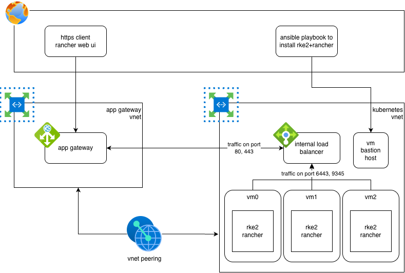

In this post I will go through the steps needed to deploy a Kubernetes RKE2 cluster with Rancher on top of it. I used Terraform to define the infrastructure resource on Azure and Ansible to configure RKE2, Rancher and its dependencies. **NOTE**: this project is a demo environment and should not be used in production.

Terraform source code is available at: https://github.com/andregri/terraform-azure-infrastructure/tree/main/rancher

Ansible configuration is available at: https://github.com/andregri/ansible-playbook-rke2-rancher

# Terraform and Azure
The terraform configuration creates the infrastructure depicted in the following diagram:


The virtual network for kubernetes contains:
- 3 virtual machines to hosts 3 control plane nodes of RKE2 Kubernetes distribution
- 1 azure bastion host to connect from my local environments and to configure the VMs through Ansible
- 1 internal Load Balancer with a private IP addres to balance traffic on ports 6443 (RKE2 kube-apiserver), 9345 (RKE2 server traffic), 80 (rancher http traffic), 443 (rancher https traffic).

The virtual network for the app gateway contains 1 application gateway that listens on ports 80 and 443 and forwards the traffic to the internal load balancer. See the `app-gateway.tf` file.

The terraform configuration also manages the creation of a certification chain:
- file `root-ca.tf` creates a self-signed root CA (certification authority)
- file `intermediate-ca.tf` creates an intermediate CA signed by the root CA.
- file `server-cert.tf` creates the server certificate exposed by the Azure app gateway.

# Ansible
The ansible repository is structured in many playbooks whose name follows the following convention `NNN-<playbook-name>.yaml`.

The playbooks allows to:
- install RKE2 kubernetes distribution on the VMs
- install Helm
- install cert-manager helm chart responsible to generate the Rancher certificate
- install rancher helm chart
- install the system upgrade controller for automatic upgrades of RKE2

Unlike other provider AWS and GCP, Azure bastion host can't be used as proxy for ssh connections towards Azure VMs. In order to connect to Azure VMs you need:
- create a ssh tunnel through the bastion host on a port with command:
```bash
az network bastion tunnel --name "${BASTION_HOST_NAME}" --resource-group ${TF_VAR_resource_group_name} --target-resource-id ${VM_HOST_ID_0} --resource-port "22" --port "${VM_0_PORT}" &
```
- connect to the VM through the tunnel:
```bash
ssh testadmin@127.0.0.1 -p ${VM_0_PORT} -o StrictHostKeyChecking=accept-new -o UserKnownHostsFile=/dev/null
```

When the ssh tunnel is created for each VM, it is possible to run the ansible playboook.

# Rancher
Rancher can be configured to use a self-signed certificate provided by cert-manager.

Otherwise, Rancher can be configured with a private CA and cert-manager create and auto-renew the server certificate. The certificate is then created as kubernetes secret and used by the Traefik ingress.

To correctly setup the Azure App Gateway to communicate with the Traefik ingress over HTTPS, you need to configure root CA in the `backend_http_settings` dynamic block on Terraform code.

```tf
resource "azurerm_application_gateway" "appgw" {
  ...
  backend_http_settings {
    name                  = local.backend_https_settings_name
    cookie_based_affinity = "Disabled"

    protocol = "Https"
    port     = 443

    trusted_root_certificate_names = [
      "root-ca"
    ]

    probe_name = "https_probe"

    request_timeout = 30
  }
}
```

# RKE2 upgrades

It is possible to automatically upgrade the RKE2 installed on VMs using the system-upgrade-controller. The controller watches for custom resources `Plan` that defines a release channel (eg. stable, latest), the concurrency of upgrading nodes ,and optionally a maintainance window.